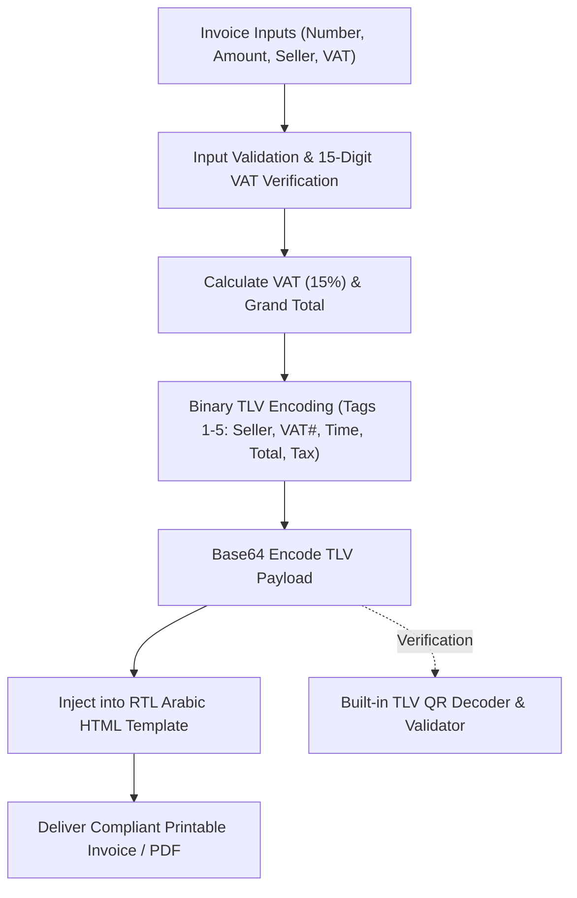

# 🧾 arabic-pdf-invoice-builder

[](https://github.com/MobileConduit/arabic-pdf-invoice-builder/releases/tag/v1.0.0)
[](https://github.com/MobileConduit/arabic-pdf-invoice-builder/actions/workflows/ci.yml)
[](LICENSE)
[](https://zatca.gov.sa)
[](https://github.com/MobileConduit)
[](https://github.com/MobileConduit)

Specialized Arabic financial invoicing engine generating pixel-perfect RTL documents and compliant Base64 TLV electronic invoice QR codes for ZATCA (Saudi Arabia / Fatoora Phase 2) and GCC e-invoicing mandates.

---

## 🏛 Architecture & ZATCA Generation Workflow



---

## 🌟 Key Features

- **ZATCA Phase 2 TLV QR Code Generator**: Encodes Tag-Length-Value binary structures compliant with Saudi ZATCA / Fatoora standards.
- **Built-in TLV Payload Decoder**: Inspects and audits existing Base64 TLV QR strings directly from Python or CLI.
- **Pixel-Perfect RTL Typography**: Clean Arabic invoice layout with Cairo / Tahoma styling ready for printing or PDF rendering.
- **Strict Input Validation**: Validates VAT registration numbers, amounts, tax fractions, and date timestamps.
- **Zero External Dependencies**: Pure Python standard library implementation with zero external package bloat.

---

---

## ⚙️ Installation & Setup

```bash
git clone https://github.com/MobileConduit/arabic-pdf-invoice-builder.git
cd arabic-pdf-invoice-builder
pip install -r requirements.txt
```

## 🚀 Quick Start & CLI Usage

### 1. Generate an Invoice:
```bash
python invoice_builder.py --inv "INV-2026-88" --amount 25000 --out invoice.html
```

### 2. Custom Seller, Tax Rate, and Date:
```bash
python invoice_builder.py \
  --inv "INV-2026-102" \
  --amount 18500.50 \
  --seller "شركة التقنية المتقدمة" \
  --vat-num "310000000000003" \
  --tax-rate 0.15 \
  --desc "تطوير برمجيات وخدمات استشارية سحابية" \
  --out invoice_custom.html
```

### 3. Decode & Verify a ZATCA TLV QR Payload:
```bash
python invoice_builder.py --decode-qr "AQbZhdi02LPYpSAzMTAwMDAwMDAwMDAwMDMCEDIwMjYtMTAtMDFUMTI6MDA6MDBaBDE0Mzc1LjAwBTE4NzUuMDA="
```

---

## 📦 Python API Usage

```python
from pathlib import Path
from invoice_builder import generate_invoice, decode_zatca_tlv_qr

# Generate an invoice document
qr_payload, vat_amount, grand_total = generate_invoice(
    invoice_num="INV-2026-001",
    amount=10000.0,
    out_file=Path("my_invoice.html"),
    seller_name="مؤسسة الحلول المتقدمة",
    vat_num="310000000000003",
    tax_rate=0.15,
    currency="ر.س"
)

print(f"VAT: {vat_amount} SAR, Total: {grand_total} SAR")
print(f"TLV QR: {qr_payload}")

# Inspect and verify TLV tags
decoded_tags = decode_zatca_tlv_qr(qr_payload)
print(f"Decoded Seller: {decoded_tags[1]}")
print(f"Decoded Total: {decoded_tags[4]}")
```

---

## ⚙️ Configuration (.env)

A `.env.example` file is included for enterprise environment defaults:
```bash
cp .env.example .env
```

Configuration keys:
- `INVOICE_SELLER_NAME`: Default legal business name.
- `INVOICE_VAT_NUMBER`: 15-digit ZATCA tax registration number.
- `INVOICE_TAX_RATE`: Default VAT rate fraction (e.g. `0.15`).
- `INVOICE_CURRENCY`: Default currency symbol (e.g. `ر.س`).

---

## 🧪 Running Automated Tests

Run the full unit test suite:
```bash
python -m unittest discover tests -v
```

---

## 👤 Author & Maintainer

**Eng. MHD. Shadi AL-Hasan**  
- **Role:** Executive CTO & Enterprise Solutions Architect  
- **Email:** [mhd.shadi.alhasan@gmail.com](mailto:mhd.shadi.alhasan@gmail.com)  
- **Phone / WhatsApp:** [+963934005922](tel:+963934005922)  
- **Location:** Damascus, Syria  
- **GitHub:** [MobileConduit](https://github.com/MobileConduit)  

---

## 📄 License

This project is licensed under the MIT License - see the [LICENSE](LICENSE) file for details.  
Copyright (c) 2026 **MHD. Shadi AL-Hasan**. All rights reserved.